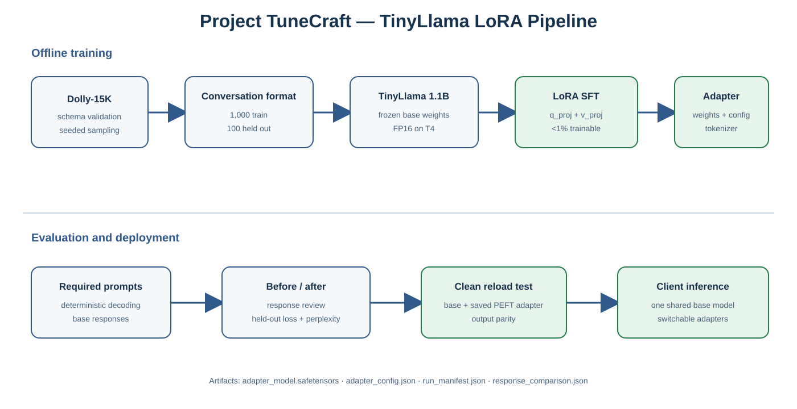

# Project TuneCraft: LoRA Fine-Tuning TinyLlama

This repository implements an end-to-end parameter-efficient fine-tuning pipeline for `TinyLlama/TinyLlama-1.1B-Chat-v1.0` using LoRA and the Databricks Dolly-15K instruction dataset. It is designed for a Google Colab T4 GPU and produces qualitative and quantitative evidence of supervised fine-tuning.

The complete implementation is in [`notebooks/LoRA_Assignment.ipynb`](notebooks/LoRA_Assignment.ipynb).

## Pipeline Architecture



```text
Databricks Dolly-15K
    -> schema validation and deterministic shuffle
    -> 1,000 training + 100 held-out examples
    -> TinyLlama conversational message format
    -> token-length and truncation diagnostics
    -> TinyLlama 1.1B base model
    -> LoRA injection into q_proj and v_proj
    -> TRL SFTTrainer (only adapter parameters update)
    -> held-out loss/perplexity + response comparison
    -> lightweight adapter save and clean reload verification
```

See [`data/architecture/lora_fine_tuning_architecture.md`](data/architecture/lora_fine_tuning_architecture.md) for the offline training and online inference paths.

## Grading Coverage

| Evaluation pillar | Evidence in the notebook |
|---|---|
| Base Model Evaluation | Deterministic responses for both required prompts and pre-training held-out loss/perplexity |
| Dataset Engineering | Schema checks, context-aware Dolly conversion, fixed-seed train/eval split, role assertions, and token-length diagnostics |
| LoRA Configuration & Injection | Required rank/alpha/dropout, `q_proj`/`v_proj` targeting, layer inspection, trainable tensor audit, and `<1%` assertion |
| Supervised Fine-Tuning | Hardware-conditional BF16/FP16, asserted gradient checkpointing, cosine schedule, warmup, effective batch size 16, stepwise loss/learning-rate diagnostics, runtime, optimizer-step completion, peak GPU memory, and final loss |
| Adapter Persistence & Evaluation | Adapter-only save, artifact size, identical prompt/decoding assertions, side-by-side outputs, held-out metric delta, manifest, and clean PEFT reload parity test |

## Fixed Assignment Configuration

| Setting | Value |
|---|---:|
| Base model | `TinyLlama/TinyLlama-1.1B-Chat-v1.0` |
| Dataset | `databricks/databricks-dolly-15k` |
| Training examples | 1,000 |
| Held-out examples | 100 |
| Maximum sequence length | 512 tokens |
| LoRA rank / alpha / dropout | 8 / 16 / 0.05 |
| Target modules | `q_proj`, `v_proj` |
| Learning rate | `2e-4` |
| Epochs | 1 |
| Device batch / accumulation | 4 / 4 |
| Effective batch size | 16 |
| Scheduler | Cosine, 3% warmup |

## Evaluation Design

The notebook uses three complementary checks:

1. **Held-out cross-entropy and perplexity:** measured on 100 Dolly records excluded from training, before and after SFT.
2. **Deterministic response comparison:** greedy decoding removes sampling noise from the base/tuned comparison.
3. **Human-readable rubric:** instruction compliance, factual coherence, relevance, clarity, and concision are reviewed for both required prompts.

The numerical results are intentionally not pre-filled because they must come from the evaluator's fresh Colab execution. The run writes `run_manifest.json` and `response_comparison.json` under `sft-lora-tinyllama/`.

## Repository Layout

```text
lora-fine-tuning/
|-- notebooks/
|   `-- LoRA_Assignment.ipynb
|-- data/
|   `-- architecture/
|       |-- lora_fine_tuning_architecture.md
|       `-- lora_fine_tuning_architecture.svg
|-- artifacts/
|   `-- local_checkpoint/
|       `-- README.txt
|-- Dockerfile
|-- requirements-local.txt
|-- instructions.md
|-- .gitignore
|-- .dockerignore
|-- LICENSE
`-- README.md
```

Generated adapters, checkpoints, tokenizer copies, metrics, and caches are excluded from Git because they are reproducible runtime artifacts.

## Run in Google Colab

1. Open `notebooks/LoRA_Assignment.ipynb` in Colab.
2. Select **Runtime -> Change runtime type -> T4 GPU**.
3. If the runtime was previously used for package installation, select **Runtime -> Disconnect and delete runtime**, reconnect to a T4, then run all cells. A normal restart does not undo incompatible pip upgrades.
4. Confirm every assertion passes, including gradient checkpointing, hardware-selected precision, `<1%` trainable parameters, equal evaluation inputs, completed optimizer steps, final artifacts, and adapter reload parity.
5. Review the stepwise diagnostics, base/tuned responses, and held-out metric table.
6. Save and download the executed notebook with all outputs.

No Hugging Face token is normally required because TinyLlama and Dolly are public. If access rules change, supply `HF_TOKEN` through Colab Secrets or an environment variable; never hardcode it.

The setup cell deliberately leaves Colab's preinstalled `torch` and `torchvision` untouched. Installing a different torch version without its matching torchvision build causes import failures such as `torchvision::nms does not exist`.

The setup also removes Colab's optional TorchAO package. It is not used by FP16 LoRA, and older TorchAO builds can prevent current PEFT from injecting adapters.

## Run Locally

A CUDA-capable NVIDIA GPU is strongly recommended. From the project root:

```powershell
py -3.12 -m venv .venv
Set-ExecutionPolicy -Scope Process -ExecutionPolicy Bypass
.\.venv\Scripts\Activate.ps1
python -m pip install --upgrade pip
python -m pip install torch --index-url https://download.pytorch.org/whl/cu124
python -m pip install -r requirements-local.txt
python -m jupyter lab notebooks\LoRA_Assignment.ipynb
```

## Generated Artifacts

After a successful run, `sft-lora-tinyllama/final-adapter/` contains the LoRA weights, adapter configuration, and tokenizer files. The 1.1B base weights are not duplicated.

| Artifact | Purpose |
|---|---|
| `adapter_model.safetensors` | Learned LoRA parameters |
| `adapter_config.json` | PEFT configuration and base-model reference |
| Tokenizer files | Reproducible inference formatting |
| `run_manifest.json` | Hyperparameters, versions, GPU, losses, and adapter size |
| `response_comparison.json` | Base and tuned responses plus transparent diagnostics |
| `training_history.csv` | Stepwise training/evaluation metrics used for diagnostics |

## Design Trade-offs

- Updating only attention query/value projections keeps the adapter far below 1% of total parameters, but broader targeting could improve adaptation.
- One epoch over 1,000 examples is practical on a T4, but is not a production-scale tuning study.
- A 512-token cap is a Colab T4 compute-quality trade-off: the sampled analysis shows about 92% of examples fit, while longer context increases memory use and training time.
- Greedy generation improves reproducibility, while sampling may be preferable for a creative writing product.
- Held-out loss measures fit to Dolly-style text, not enterprise style preference. Production work should add client-specific blind evaluation sets.

## Final Submission Checklist

1. Restart Colab and run every cell from top to bottom.
2. Confirm no exception, skipped cell, or stale output remains.
3. Verify exactly 1,000 training and 100 held-out examples.
4. Verify only LoRA tensors under `q_proj` and `v_proj` are trainable and the ratio is below 1%.
5. Review training loss, held-out loss/perplexity, and both response pairs.
6. Confirm the adapter is saved and the clean reload test passes.
7. Download the freshly executed `.ipynb` for evaluation.

## License

This project is distributed under the terms in [`LICENSE`](LICENSE).
